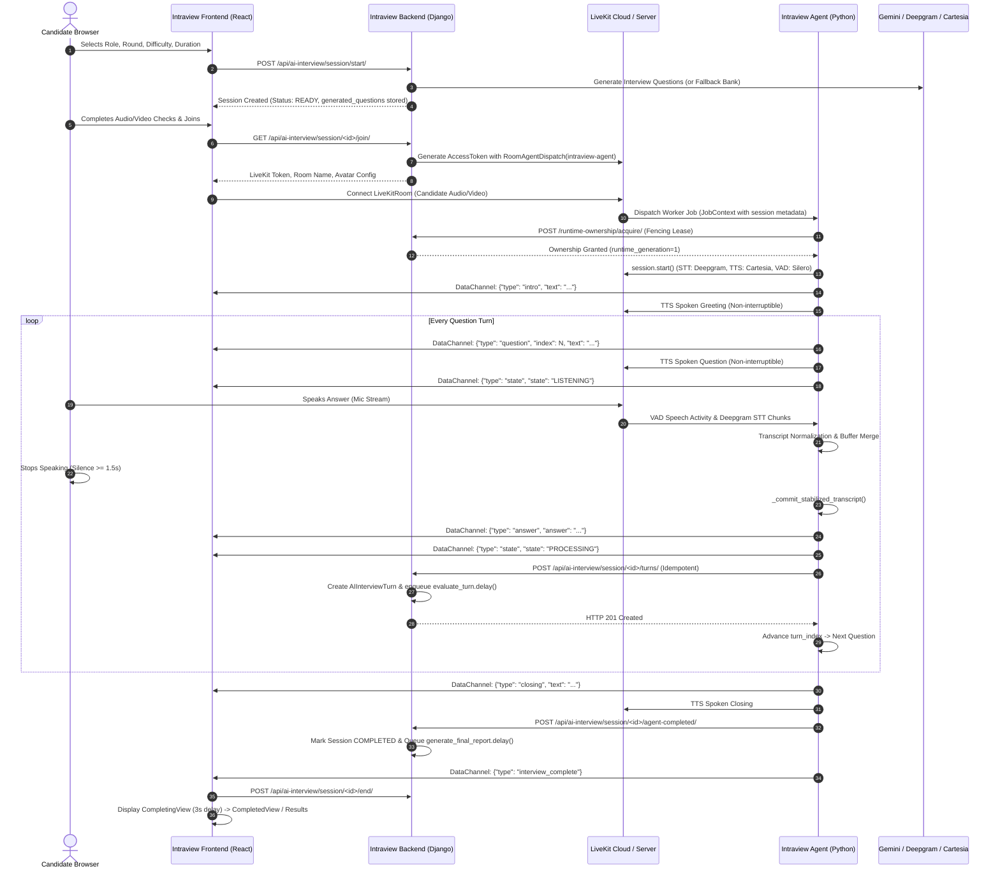
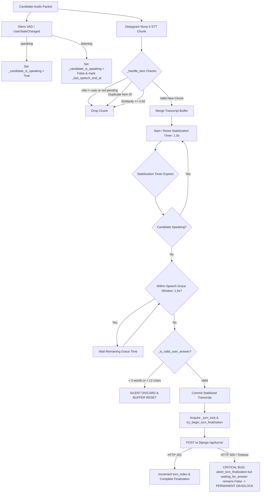
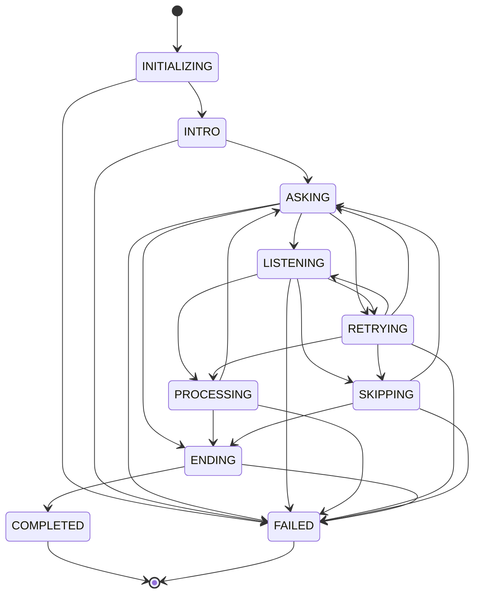
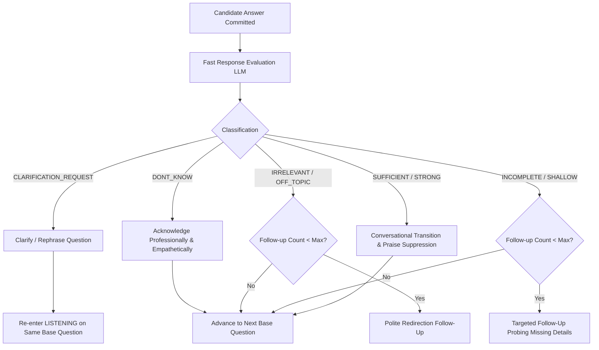
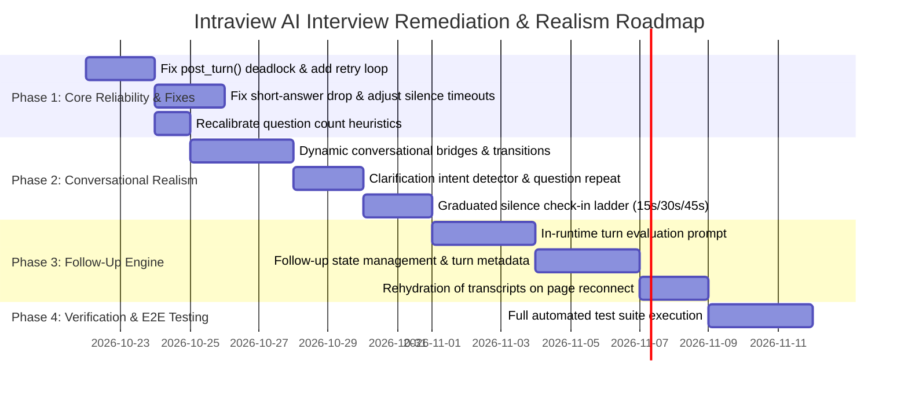

# Intraview AI Interview System: Comprehensive Technical Audit & Realism Architecture Report

---

## Executive Summary

This comprehensive audit evaluates the end-to-end AI Mock Interview feature in **Intraview** across its three core pillars:
1. **AI Agent Runtime (`intraview-agent/`)**: Python LiveKit Agents SDK v1.5+, Deepgram Nova-3 STT, Google Gemini 2.5 Flash, Cartesia Sonic-3.5 TTS, Silero VAD, and Tavus Video Avatar.
2. **Backend Server (`intraview/ai_interviews/`)**: Django REST Framework, Celery asynchronous workers, PostgreSQL database, and Gemini evaluation pipelines.
3. **Frontend Application (`Intraview-frontend/`)**: React 18, Redux Toolkit, `@livekit/components-react`, WebRTC audio/video streams, and MediaPipe Vision integrity monitoring.

### Key Audit Findings
- **Strengths**: The system exhibits robust runtime fencing (`RuntimeGuard`), strict turn idempotency (`UniqueConstraint` on `session` and `turn_index`), and clean WebRTC room dispatch via LiveKit tokens.
- **Critical Architectural Flaws**:
  1. **Deadlock on Backend Network Failure**: If `post_turn()` fails in `runtime.py:2695-2700`, the turn finalization lock is released, but `waiting_for_answer` remains `False`. The timeout loop ignores the session, leaving the candidate permanently stranded in `PROCESSING` state with no recovery.
  2. **Unnatural Silence Deadbands**: Silence detection triggers a retry only after **75 seconds**, and question skip only after **150 seconds (2.5 minutes)**. In a 10-15 minute interview, a single silent question consumes 15–25% of the total session duration.
  3. **Silent Drop of Short Answers**: `_is_valid_user_answer()` strictly requires $\ge 12$ characters and $\ge 3$ words. One- or two-word candidate responses ("Yes", "No", "Python", "Sure") are silently discarded, causing the agent to sit in dead silence for 75 seconds.
  4. **Premature Speech Truncation**: A candidate pause of **1.5 seconds** (`SPEECH_END_GRACE_SECONDS`) triggers answer commitment. Candidates pausing to think mid-sentence are cut off, and any resumed speech is dropped.
  5. **Total Interruption Lockout**: `allow_interruptions=False` is hardcoded across all agent speech invocations, and `"discard_audio_if_uninterruptible": True` is configured in LiveKit. Candidates cannot interrupt, pause, or query the interviewer while it speaks.
  6. **Question Clarifications Graded as 0/10 Answers**: Any candidate query (e.g., "Can you repeat the question?" or "What language should I use?") is committed as the candidate's final technical answer and graded by Gemini.
  7. **Absence of Conversational Intelligence**: No conversational transitions exist between questions, candidate admissions of "I don't know" are passed without empathetic acknowledgment, and no adaptive follow-up questioning exists.
  8. **Inverted Question Count Heuristic**: Backend question generation estimates 13–14 questions for a 15-minute interview (~1 min/question, an unrealistic interrogation rate), while 30-minute interviews are assigned only 12–15 questions due to a logic bug.

---

## 1. End-to-End Workflow Architecture & Codebase Inspection

The interview workflow connects three decoupled systems via WebRTC media channels, LiveKit reliable data channels, and authenticated HTTP REST endpoints.



### Component Breakdown
1. **Frontend Hook [`useAgentTranscript.js`](file:///home/ijaz/Documents/weeks/Week%2024%20%28Project%29/Project/Intraview/Intraview-frontend/src/features/aiInterview/hooks/useAgentTranscript.js)**:
   - Decodes incoming Uint8Array data packets over LiveKit DataChannel.
   - Listens for packet types: `intro`, `question`, `answer`, `closing`, `state`, `info`, and `interview_complete`.
   - Maintains local state array `messages` and dedupes using `${type}-${index}-${text.slice(0, 40)}`.
2. **Agent Core [`runtime.py`](file:///home/ijaz/Documents/weeks/Week%2024%20%28Project%29/Project/Intraview/intraview-agent/src/runtime.py)**:
   - 3,316 lines managing the `AgentSession`, Silero VAD, Deepgram Nova-3 STT, Cartesia Sonic TTS, and background loops.
   - Enforces single active turns via `TurnManager` and `asyncio.Lock` primitives (`_turn_lock`, `_generation_lock`).
   - Suppresses autonomous agent replies by throwing `livekit.agents.StopResponse()` inside `InterviewAgent.on_user_turn_completed()`.
3. **Turn Manager [`turn_manager.py`](file:///home/ijaz/Documents/weeks/Week%2024%20%28Project%29/Project/Intraview/intraview-agent/src/turn_manager.py)**:
   - Tracks `turn_index`, `waiting_for_answer`, `last_question_time`, and `is_finalizing_turn`.
   - Manages transcript buffer updates, length comparisons, and commit markers.
4. **Backend Ingestion [`views.py`](file:///home/ijaz/Documents/weeks/Week%2024%20%28Project%29/Project/Intraview/intraview/ai_interviews/views.py) & [`services.py`](file:///home/ijaz/Documents/weeks/Week%2024%20%28Project%29/Project/Intraview/intraview/ai_interviews/service/services.py)**:
   - `RecordTurnFromAgentView` validates `AgentTokenAuthentication` and delegates to `AIInterviewTurnService.create_turn()`.
   - Enforces idempotency via `models.UniqueConstraint(fields=["session", "turn_index"], name="uniq_turn_per_session_index")`.
   - Dispatches Celery task `evaluate_turn.delay(turn.id)`.

---

## 2. Exhaustive Bug, Loophole & Edge Case Audit Matrix

| Scenario / Interaction | Status | File & Line Reference | Root Cause & Failure Mechanism | Severity |
| :--- | :--- | :--- | :--- | :--- |
| **Silence for 5s, 15s, 30s** | **Partially Handled (Poorly Calibrated)** | [`constants.py:10`](file:///home/ijaz/Documents/weeks/Week%2024%20%28Project%29/Project/Intraview/intraview-agent/src/constants.py#L10)<br>[`turn_manager.py:213`](file:///home/ijaz/Documents/weeks/Week%2024%20%28Project%29/Project/Intraview/intraview-agent/src/turn_manager.py#L213) | `NO_ANSWER_TIMEOUT_SECONDS = 75.0`. No check-in occurs at 10s or 20s. Agent waits in dead silence for 1 min 15 sec before repeating, and 2.5 min before skipping. | **High** |
| **One-word / Incomplete Answer** | **Not Handled / Destructive** | [`runtime.py:1052-1060`](file:///home/ijaz/Documents/weeks/Week%2024%20%28Project%29/Project/Intraview/intraview-agent/src/runtime.py#L1052-L1060)<br>[`runtime.py:1459-1467`](file:///home/ijaz/Documents/weeks/Week%2024%20%28Project%29/Project/Intraview/intraview-agent/src/runtime.py#L1459-L1467) | Answers with $< 12$ chars or $< 3$ words fail `_is_valid_user_answer()` and are silently discarded via `_reset_transcript_buffer()`. The user thinks they answered, but agent remains silent for 75s. | **Critical** |
| **Candidate says "I don't know"** | **Partially Handled (Unnatural)** | [`runtime.py:1649-1695`](file:///home/ijaz/Documents/weeks/Week%2024%20%28Project%29/Project/Intraview/intraview-agent/src/runtime.py#L1649-L1695) | If $\ge 3$ words ("I don't know"), it is committed as the answer with zero acknowledgment and posted to DB. The agent instantly blurts out the next question with no transition. | **High** |
| **Candidate asks for Clarification** | **Not Handled / Erroneous** | [`runtime.py:1455-1540`](file:///home/ijaz/Documents/weeks/Week%2024%20%28Project%29/Project/Intraview/intraview-agent/src/runtime.py#L1455-L1540)<br>[`runtime.py:1650`](file:///home/ijaz/Documents/weeks/Week%2024%20%28Project%29/Project/Intraview/intraview-agent/src/runtime.py#L1650) | Asking "Could you clarify what you mean?" is treated as the official answer, posted to backend, graded 0/10 by Gemini, and burns the question slot. | **Critical** |
| **Mid-answer Pause (1.5s - 3s)** | **Partially Handled (Overly Aggressive)** | [`constants.py:113`](file:///home/ijaz/Documents/weeks/Week%2024%20%28Project%29/Project/Intraview/intraview-agent/src/constants.py#L113)<br>[`runtime.py:1195-1197`](file:///home/ijaz/Documents/weeks/Week%2024%20%28Project%29/Project/Intraview/intraview-agent/src/runtime.py#L1195-L1197) | `SPEECH_END_GRACE_SECONDS = 1.5`. Pausing for 1.6s to think mid-sentence triggers immediate answer finalization. Resumed candidate speech is permanently rejected. | **High** |
| **Candidate Interrupts Agent** | **Not Handled / Blocked by Design** | [`runtime.py:418, 540`](file:///home/ijaz/Documents/weeks/Week%2024%20%28Project%29/Project/Intraview/intraview-agent/src/runtime.py#L418)<br>[`runtime.py:945`](file:///home/ijaz/Documents/weeks/Week%2024%20%28Project%29/Project/Intraview/intraview-agent/src/runtime.py#L945) | `_safe_say()` specifies `allow_interruptions=False` and LiveKit is configured with `discard_audio_if_uninterruptible=True`. The candidate cannot interrupt the agent under any circumstances. | **High** |
| **Answer Restart / Correction** | **Partially Handled (Flawed Heuristic)** | [`turn_manager.py:287-291`](file:///home/ijaz/Documents/weeks/Week%2024%20%28Project%29/Project/Intraview/intraview-agent/src/turn_manager.py#L287-L291)<br>[`runtime.py:2288-2354`](file:///home/ijaz/Documents/weeks/Week%2024%20%28Project%29/Project/Intraview/intraview-agent/src/runtime.py#L2288-L2354) | `if existing and len(cleaned) < len(existing): return`. If candidate says "Let me restart" and gives a shorter answer, `turn_manager` discards it. Case 4 concatenates disjoint false starts into one mangled string. | **Medium** |
| **Delayed STT Chunk Delivery** | **Not Handled** | [`runtime.py:2112-2115`](file:///home/ijaz/Documents/weeks/Week%2024%20%28Project%29/Project/Intraview/intraview-agent/src/runtime.py#L2112-L2115) | If Deepgram emits a final chunk $> 1.5s$ after speech ends due to network latency, `has_pending_question()` is already `False`. The final segment is permanently dropped. | **Medium** |
| **Prompt Injection / Abuse / Joking** | **Not Handled** | [`evaluation.py:14-48`](file:///home/ijaz/Documents/weeks/Week%2024%20%28Project%29/Project/Intraview/intraview/ai_interviews/service/gemini/evaluation.py#L14-L48) | Candidate answers are directly interpolated into Gemini JSON prompts without adversarial boundary checks or sanitization. No conversational moderation exists. | **Medium** |
| **Backend `post_turn()` Failure** | **Fatal Deadlock** | [`runtime.py:2695-2700`](file:///home/ijaz/Documents/weeks/Week%2024%20%28Project%29/Project/Intraview/intraview-agent/src/runtime.py#L2695-L2700) | `except Exception: self.tm.abort_turn_finalization(); return`. `waiting_for_answer` was already set to `False`. The timeout loop ignores the turn. The session freezes indefinitely in `PROCESSING`. | **Critical** |
| **Page Refresh / Reconnect Loss of Transcript** | **Partially Handled** | [`useAgentTranscript.js:20`](file:///home/ijaz/Documents/weeks/Week%2024%20%28Project%29/Project/Intraview/Intraview-frontend/src/features/aiInterview/hooks/useAgentTranscript.js#L20)<br>[`LiveInterviewPage.jsx:257`](file:///home/ijaz/Documents/weeks/Week%2024%20%28Project%29/Project/Intraview/Intraview-frontend/src/features/aiInterview/pages/LiveInterviewPage.jsx#L257) | Frontend stores transcript in in-memory React state. Upon refresh or network reconnect, the right-hand transcript panel is wiped blank; past turns are never rehydrated from backend. | **Medium** |
| **Inverted Question Count Heuristics** | **Logic Bug** | [`question_generation.py:32-44`](file:///home/ijaz/Documents/weeks/Week%2024%20%28Project%29/Project/Intraview/intraview/ai_interviews/service/gemini/question_generation.py#L32-L44) | 15-minute interviews generate 13–14 questions (impossible pacing), 25-minute interviews generate 23–24 questions, while 30-minute interviews generate only 12–15 questions due to broken piecewise bounds. | **High** |

---

## 3. Interviewer Intelligence & Conversational Realism Audit

### 3.1 Pacing and Question Density
- **The Issue**: [`question_generation.py:32-44`](file:///home/ijaz/Documents/weeks/Week%2024%20%28Project%29/Project/Intraview/intraview/ai_interviews/service/gemini/question_generation.py#L32-L44) calculates question counts with `minutes_per_question` between $1.05$ and $1.75$ minutes. For a 15-minute interview, it sets `desired_question_count` to $13$ or $14$.
- **Real-World Impact**: In a genuine interview, an interviewer asks $4$ to $6$ substantial questions in 15–20 minutes, allowing the candidate 2–3 minutes per response. Asking 14 questions in 15 minutes forces an interrogation speed of 60 seconds per question (including speech synthesis and silence grace), leaving no room for elaboration.

### 3.2 The Greeting Sequence
- **Current Implementation**:
  ```python
  # runtime.py:316-330 & 2817-2824
  greeting_text = self._build_greeting_text()
  # "Take a moment to settle in, and when you are ready, we will begin."
  await self._safe_say(text=greeting_text, allow_interruptions=False)
  await self._ask_current_prepared_question(self.planner.total_questions())
  ```
- **Realism Flaw**: The agent tells the candidate: *"Take a moment to settle in, and when you are ready, we will begin."* Immediately and without a millisecond of delay or candidate acknowledgment, it launches directly into Question 1. A human interviewer waits for the candidate to say "I'm ready, thank you," or says "Let's dive right in with our first question."

### 3.3 Robotic, Non-Existent Question Transitions
- **Current Implementation**:
  ```python
  # runtime.py:2728-2736
  if self.tm.can_ask_new_question():
      await self._ask_current_prepared_question(total_q)
  ```
- **Realism Flaw**: When a candidate finishes an answer, the interviewer commits the transcript and speaks the next question without any transitional bridge. A human interviewer says:
  - *"Thank you for sharing that. Moving on to technical problem-solving..."*
  - *"Got it. Let's shift gears slightly and talk about teamwork..."*
  - *"Understood. Building on that theme, I'd like to ask..."*

### 3.4 Silence Check-in & Retry Realism
- **Current Implementation**: A single monolithic timeout of 75.0s (`NO_ANSWER_TIMEOUT_SECONDS`).
- **Realism Flaw**: In human interviews, silence is addressed in stages:
  - **12–15 seconds**: Gentle human check-in (*"Take your time, let me know if you'd like a moment or if you need me to repeat the question."*).
  - **30–35 seconds**: Active prompt (*"Whenever you're ready, please share your thoughts, or we can move on to the next topic if you prefer."*).
  - **50–60 seconds**: Graceful advancement (*"No problem at all. Let's move on to the next question."*).

---

## 4. Audit of Existing Guards, Filters, and Error Handling



### Detailed Evaluation of Existing Guards:
1. **`_is_valid_user_answer()` ([`runtime.py:1033`](file:///home/ijaz/Documents/weeks/Week%2024%20%28Project%29/Project/Intraview/intraview-agent/src/runtime.py#L1033))**:
   - **Mechanism**: Rejects answers where `len(cleaned) < 12` or `len(words) < 3`.
   - **Critique**: Designed to ignore microphone clicks, but acts as a silent black hole for valid short utterances ("Yes", "No", "Docker", "Never"). Must be replaced with intent classification.
2. **`try_begin_turn_finalization()` ([`turn_manager.py:149`](file:///home/ijaz/Documents/weeks/Week%2024%20%28Project%29/Project/Intraview/intraview-agent/src/turn_manager.py#L149))**:
   - **Mechanism**: Atomic check-and-set flag `is_finalizing_turn`.
   - **Critique**: Properly fences timeout loops and delayed callbacks, but recovery logic is incomplete upon backend failure.
3. **`_safe_say()` Interruptibility Lockout ([`runtime.py:414`](file:///home/ijaz/Documents/weeks/Week%2024%20%28Project%29/Project/Intraview/intraview-agent/src/runtime.py#L414))**:
   - **Mechanism**: Hardcodes `allow_interruptions=False`.
   - **Critique**: Prevents accidental TTS clipping, but creates a completely deaf interviewer that talks over the user.
4. **`_transcript_similarity()` ([`runtime.py:1089`](file:///home/ijaz/Documents/weeks/Week%2024%20%28Project%29/Project/Intraview/intraview-agent/src/runtime.py#L1089))**:
   - **Mechanism**: `SequenceMatcher(None, a, b).ratio() >= 0.92`.
   - **Critique**: Effective against duplicate STT emissions, but can suppress valid repeated candidate confirmations.

---

## 5. Workflow and State Machine Audit

### Current State Transition Graph
The state machine defined in [`state.py`](file:///home/ijaz/Documents/weeks/Week%2024%20%28Project%29/Project/Intraview/intraview-agent/src/state.py) enforces legal transitions:



### Flaws and Missing States:
1. **No `CLARIFYING` State**: When a user asks "Can you repeat the question?", the system lacks a state to rephrase or repeat without counting it as an answer or consuming the question turn.
2. **No `FOLLOW_UP` States**: The state machine contains no `FOLLOWUP_ASKING` or `FOLLOWUP_LISTENING` state. If follow-ups are introduced, transitioning `PROCESSING -> ASKING` without completing the base turn causes turn index corruption.
3. **No `PAUSED` / `RECONNECTING` State**: If the candidate disconnects, the agent continues running its timeout loop (paused only by `len(remote_participants) == 0`). If reconnect takes 40 seconds, the session state is ambiguous.
4. **Permanent Deadlock State**:
   - In `runtime.py:2695-2700`: Backend POST fails -> `abort_turn_finalization()` sets `is_finalizing_turn=False`.
   - State machine remains in `PROCESSING`.
   - `waiting_for_answer` is `False`.
   - `_timeout_loop` ignores it.
   - The session stays in `PROCESSING` indefinitely.

---

## 6. Prioritized Actionable Recommendations Matrix

### Priority 1: Critical (Must Fix - System Deadlocks & Broken Core Logic)

#### Issue 1.1: Permanent Deadlock on Backend `post_turn()` Network/Server Failure
- **Affected File**: [`intraview-agent/src/runtime.py:2670-2700`](file:///home/ijaz/Documents/weeks/Week%2024%20%28Project%29/Project/Intraview/intraview-agent/src/runtime.py#L2670-L2700)
- **Code Evidence**:
  ```python
  except Exception:
      logger.exception("Error posting turn to backend")
      self.tm.abort_turn_finalization()
      return
  ```
- **Realistic Scenario**: The candidate finishes Question 2. A 2-second backend network spike causes `post_turn()` to throw a timeout. `abort_turn_finalization()` resets `is_finalizing_turn = False`, but `self.tm.state.waiting_for_answer` was already set to `False` in line 1512. The timeout loop ignores the session because `waiting_for_answer` is `False`. The agent never asks Question 3. Both the candidate and agent remain connected in silence until the room expires.
- **Recommended Fix**: Implement an exponential backoff retry loop (3 attempts) around `post_turn()`. If all attempts fail, log the payload locally, salvage the turn, transition state cleanly to `ASKING`, and proceed to the next question rather than abandoning execution.
- **Priority**: **Critical** | **Confirmed Bug**

#### Issue 1.2: Silent Discard of Short Valid Answers
- **Affected File**: [`intraview-agent/src/runtime.py:1052-1060`](file:///home/ijaz/Documents/weeks/Week%2024%20%28Project%29/Project/Intraview/intraview-agent/src/runtime.py#L1052-L1060), [`turn_manager.py:287-291`](file:///home/ijaz/Documents/weeks/Week%2024%20%28Project%29/Project/Intraview/intraview-agent/src/turn_manager.py#L287-L291)
- **Code Evidence**:
  ```python
  if len(cleaned) < self._minimum_answer_chars:
      return False
  if len(words) < self._minimum_answer_words:
      return False
  ```
- **Realistic Scenario**: Interviewer asks: *"Have you ever managed Kubernetes clusters in production?"* Candidate responds: *"No, I haven't."* (3 words, 14 chars -> passes) vs *"No, never."* (2 words, 9 chars -> fails). Because it has 2 words, `_is_valid_user_answer()` returns `False`. In `_commit_stabilized_transcript()`, it logs *"Discarding unstable transcript"* and calls `_reset_transcript_buffer()`. The candidate sits waiting, while the interviewer sits mute for 75 seconds.
- **Recommended Fix**: Decouple noise rejection from length rejection. If transcript has 1–2 words, do not discard. Check if it's an acknowledgment/negation ("Yes", "No", "Never") or a filler ("Um", "Uh"). If it's a short answer, prompt for elaboration: *"Could you expand a bit more on that?"*
- **Priority**: **Critical** | **Confirmed Bug**

#### Issue 1.3: Question Clarification Requests Treated as Graded Answers
- **Affected File**: [`intraview-agent/src/runtime.py:1650-1695`](file:///home/ijaz/Documents/weeks/Week%2024%20%28Project%29/Project/Intraview/intraview-agent/src/runtime.py#L1650-L1695), [`intraview/ai_interviews/service/gemini/evaluation.py`](file:///home/ijaz/Documents/weeks/Week%2024%20%28Project%29/Project/Intraview/intraview/ai_interviews/service/gemini/evaluation.py)
- **Code Evidence**: All transcripts committed by `_commit_stabilized_transcript()` are passed directly to `_process_finalized_answer()` without intent detection.
- **Realistic Scenario**: The candidate says: *"Could you repeat that question please?"* The runtime treats this as the candidate's final technical answer to the question, commits it, sends it to the backend, grades it 0/10, and advances to the next question.
- **Recommended Fix**: Add a fast, lightweight regex/intent classification guard prior to committing an answer. If candidate text matches clarification intents (`repeat`, `clarify`, `say again`, `pardon`), transition to a clarification handler that repeats/rephrases the current question without incrementing `turn_index`.
- **Priority**: **Critical** | **Confirmed Bug**

---

### Priority 2: High (Realism, Timing & UX Failures)

#### Issue 2.1: Inverted & Hyperactive Question Count Heuristic
- **Affected File**: [`intraview/ai_interviews/service/gemini/question_generation.py:32-44`](file:///home/ijaz/Documents/weeks/Week%2024%20%28Project%29/Project/Intraview/intraview/ai_interviews/service/gemini/question_generation.py#L32-L44)
- **Code Evidence**:
  ```python
  if duration <= 5: lower, upper = 4, 5
  elif duration <= 10: lower, upper = 8, 9
  elif duration <= 15: lower, upper = 13, 14
  elif duration <= 20: lower, upper = 18, 19
  elif duration <= 25: lower, upper = 23, 24
  else: lower, upper = 12, 15  # For duration > 25 (e.g. 30 min)
  ```
- **Realistic Scenario**: A candidate books a 15-minute interview. The system generates 14 questions (~64 seconds per question). A candidate booking a 30-minute interview gets only 12–15 questions.
- **Recommended Fix**: Recalibrate realistic pacing:
  - 5 min: 2–3 questions.
  - 15 min: 4–6 questions (allowing 2–3 minutes per question including follow-up).
  - 30 min: 8–10 questions.
- **Priority**: **High** | **Confirmed Bug**

#### Issue 2.2: Extreme Silence Deadbands (75s / 150s)
- **Affected File**: [`intraview-agent/src/constants.py:10, 14`](file:///home/ijaz/Documents/weeks/Week%2024%20%28Project%29/Project/Intraview/intraview-agent/src/constants.py#L10)
- **Code Evidence**: `NO_ANSWER_TIMEOUT_SECONDS = 75.0`.
- **Recommended Fix**: Implement a multi-stage conversational ladder:
  - Level 1 (15s): Gentle check-in (*"Take your time, let me know if you'd like me to repeat the question."*).
  - Level 2 (30s): Supportive prompt (*"Whenever you're ready, or we can skip this one if you'd prefer."*).
  - Level 3 (45s): Graceful skip (*"Let's move on to the next question."*).
- **Priority**: **High** | **Confirmed Improvement**

#### Issue 2.3: Overly Aggressive Silence Grace Window (1.5s Truncation)
- **Affected File**: [`intraview-agent/src/constants.py:113`](file:///home/ijaz/Documents/weeks/Week%2024%20%28Project%29/Project/Intraview/intraview-agent/src/constants.py#L113)
- **Code Evidence**: `SPEECH_END_GRACE_SECONDS = 1.5`.
- **Recommended Fix**: Increase speech end grace to 2.5s for normal answers. If the candidate has spoken $> 20$ words and pauses, allow a 3.0s thinking window before committing.
- **Priority**: **High** | **Confirmed Improvement**

#### Issue 2.4: Deaf Interviewer (No Interruption Support)
- **Affected File**: [`intraview-agent/src/runtime.py:418, 540`](file:///home/ijaz/Documents/weeks/Week%2024%20%28Project%29/Project/Intraview/intraview-agent/src/runtime.py#L418)
- **Code Evidence**: `allow_interruptions=False` across all `_safe_say()` calls.
- **Recommended Fix**: Allow interruptions during greetings, retry prompts, and closing statements (`allow_interruptions=True`). For question delivery, support quick pause detection: if the candidate says "Wait" or "Excuse me", pause speech and listen.
- **Priority**: **High** | **Confirmed Improvement**

---

### Priority 3: Medium (Data Integrity & Edge Robustness)

#### Issue 3.1: Wiped Transcripts on Page Refresh / Reconnect
- **Affected File**: [`Intraview-frontend/src/features/aiInterview/hooks/useAgentTranscript.js:20`](file:///home/ijaz/Documents/weeks/Week%2024%20%28Project%29/Project/Intraview/Intraview-frontend/src/features/aiInterview/hooks/useAgentTranscript.js#L20)
- **Code Evidence**: State `messages` is initialized to `[]` and only populates via live WebRTC DataChannel messages.
- **Recommended Fix**: When `LiveInterviewPage` loads or reconnects, call `GET /api/ai-interview/session/<id>/` to fetch all already-recorded turns from the backend and populate the transcript history immediately.
- **Priority**: **Medium** | **Confirmed UX Defect**

#### Issue 3.2: Defective Length Check Dropping Answer Restarts
- **Affected File**: [`intraview-agent/src/turn_manager.py:287-291`](file:///home/ijaz/Documents/weeks/Week%2024%20%28Project%29/Project/Intraview/intraview-agent/src/turn_manager.py#L287-L291)
- **Code Evidence**:
  ```python
  if existing and len(cleaned) < len(existing):
      return
  ```
- **Recommended Fix**: Do not reject shorter incoming text if speech activity was interrupted or if a restart phrase is detected. Deepgram cumulative frames reset when a new utterance begins.
- **Priority**: **Medium** | **Confirmed Bug**

---

## 7. Separate Follow-Up Question Feature Design

To elevate the experience from an automated question-reader to an intelligent interviewer, an **Adaptive Turn Evaluation & Follow-Up Engine** must be introduced.

### 7.1 Architecture & Decision Engine

Follow-up logic must execute **in the agent runtime** before a base turn is finalized.



### 7.2 Decision State Matrix

| Candidate Response Type | Decision Action | Spoken Interviewer Response Pattern | Turn Counter Effect |
| :--- | :--- | :--- | :--- |
| **Sufficient & Complete** | `PROCEED` | Natural transition (*"Got it, that gives me a clear picture. Let's move on to..."*) | Increments `turn_index` |
| **Relevant but Incomplete** | `FOLLOW_UP` | Probing question (*"That's a helpful overview of the architecture. How did your team handle database migrations during that rollout?"*) | Stays on current `turn_index`, increments `followup_count` |
| **Vague / Hand-waving** | `FOLLOW_UP` | Concrete example request (*"Could you give me a specific real-world example from a past project where you implemented that?"*) | Stays on current `turn_index`, increments `followup_count` |
| **Off-Topic / Irrelevant** | `REDIRECT` | Gentle redirect (*"I understand that context, but coming back to the question, how did you personally resolve the conflict?"*) | Stays on current `turn_index`, increments `followup_count` |
| **Candidate "Doesn't Know"** | `ACKNOWLEDGE` | Empathetic acknowledgment (*"That's completely fine, no worries at all. Let's move on to our next area."*) | Increments `turn_index` |
| **Candidate Asks Clarification** | `CLARIFY` | Focused explanation (*"Certainly. In this context, I mean whether you used synchronous REST or asynchronous message queues."*) | Zero count change; stays on current question |

### 7.3 Guardrails & Limits
- **Max Follow-ups per Question**: Maximum $1$ follow-up for 15-minute interviews; maximum $2$ for 30-minute interviews.
- **Time Guard**: If remaining interview time is $< 2.5$ minutes, follow-up questioning is automatically suppressed.
- **Total Turn Token Limit**: Combined base answer and follow-up exchanges are stored in `AIInterviewTurn.metadata["followup_exchanges"]` and evaluated holistically by Celery tasks.

### 7.4 Prompt Design for Evaluation & Follow-Up Generation
A fast JSON prompt sent to `gemini-2.5-flash` with 2.5s timeout:
```json
{
  "system": "You are a professional hiring manager conducting a live interview. Evaluate the candidate's response to the interview question.",
  "input": {
    "question": "Describe a difficult bug you tracked down in production.",
    "candidate_answer": "I found a memory leak in the backend service and fixed it."
  },
  "rules": [
    "Classify answer as: 'SUFFICIENT', 'INCOMPLETE', 'VAGUE', 'IRRELEVANT', 'DONT_KNOW', or 'CLARIFICATION'.",
    "If INCOMPLETE or VAGUE, provide exactly ONE concise, spoken follow-up question (max 25 words).",
    "Never use cheesy praise like 'Great answer!'.",
    "If DONT_KNOW, provide an empathetic transition phrase."
  ],
  "response_schema": {
    "classification": "INCOMPLETE",
    "followup_question": "What specific tools or profiling techniques did you use to isolate that memory leak?",
    "transition_phrase": null
  }
}
```

---

## 8. Comprehensive Testing Catalog

| Test ID | Test Name | Input / User Action | Precondition | Expected System Outcome | Pass Criteria |
| :--- | :--- | :--- | :--- | :--- | :--- |
| **TC-01** | Normal Complete Answer | Candidate speaks 45 words answering the question and stops for 2.5s. | State: `LISTENING` | Answer commits cleanly, transitions to `PROCESSING`, posts turn to backend, acknowledges with natural transition, speaks Next Question. | No speech cutoff; DB record created; turn advances. |
| **TC-02** | Short Valid Answer | Candidate says: *"No, I have not worked with that."* | State: `LISTENING` | System does NOT discard; recognizes valid answer or asks for elaboration (*"Could you tell me what you've used instead?"*). | No 75s dead silence; response processed. |
| **TC-03** | Mid-sentence 2-second Pause | Candidate speaks: *"We used PostgreSQL because..."* [pauses 2.0s] *"...it supported JSONB queries."* | State: `LISTENING` | System does NOT cut off after 1.5s; waits for complete utterance; commits unified sentence. | Full sentence committed in turn metadata. |
| **TC-04** | Candidate Says "I don't know" | Candidate says: *"I don't know, I haven't done that."* | State: `LISTENING` | System acknowledges empathetically (*"No problem at all, let's try another topic."*) and cleanly advances to next question. | No awkward jump; gracious human response. |
| **TC-05** | Question Clarification Request | Candidate says: *"Could you repeat the question?"* | State: `LISTENING` | System repeats question without burning turn index or grading candidate query 0/10. | Question repeated; `turn_index` unchanged. |
| **TC-06** | 15s Silence Check-in | Candidate stays silent for 15s after question delivery. | State: `LISTENING` | Agent provides gentle prompt (*"Take your time, let me know if you need a moment."*). | Agent does not wait 75s in silence. |
| **TC-07** | Network Glitch during Turn Post | Backend `post_turn()` returns HTTP 500 or times out. | Answer Committed | Agent retries 3 times; if failing, buffers turn locally, avoids deadlock, and advances to next question. | Session does not freeze in `PROCESSING`. |
| **TC-08** | Browser Page Refresh | Candidate refreshes the browser during Question 3. | Room active | Candidate reconnects to room; past turns 1 and 2 are fetched from backend and re-rendered in transcript panel. | Transcripts preserved in UI; interview resumes on Q3. |
| **TC-09** | Shallow Answer Follow-up | Candidate gives high-level 1-sentence answer. | Follow-up count = 0 | Agent asks targeted follow-up probing technical specifics; turn index remains on Q1. | Follow-up asked; `turn_index` unchanged. |
| **TC-10** | Max Follow-up Cap | Candidate gives second shallow answer to follow-up. | Follow-up count = 1 (Max 1) | Agent accepts answer, transitions naturally, and moves to Question 2. | Strict adherence to max follow-up limit. |

---

## 9. Phased Implementation Roadmap



### Phase 1: Reliability & Deadlock Elimination
1. Wrap `post_turn()` in an exponential backoff retry loop with local failover.
2. Remove hard character/word cutoffs in `_is_valid_user_answer()` to stop silent discarding.
3. Fix the question count estimator in `question_generation.py` for realistic 15- and 30-minute pacing.

### Phase 2: Conversational Intelligence & Natural Transitions
1. Introduce dynamic question transition phrases based on topic and candidate answers.
2. Build lightweight regex/classifier for clarification requests (`"Could you repeat that?"`).
3. Replace the 75s/150s deadbands with a 15s/30s/45s graduated check-in ladder.
4. Increase speech grace window from 1.5s to 2.5s to allow candidates to think mid-sentence.

### Phase 3: Adaptive Follow-Up Questioning
1. Implement the Fast Evaluation Prompt in agent runtime to classify answers.
2. Add follow-up state scoping in `TurnManager` (storing `followup_exchanges` in turn metadata).
3. Connect frontend transcript panel to backend turn history to survive page refreshes.
